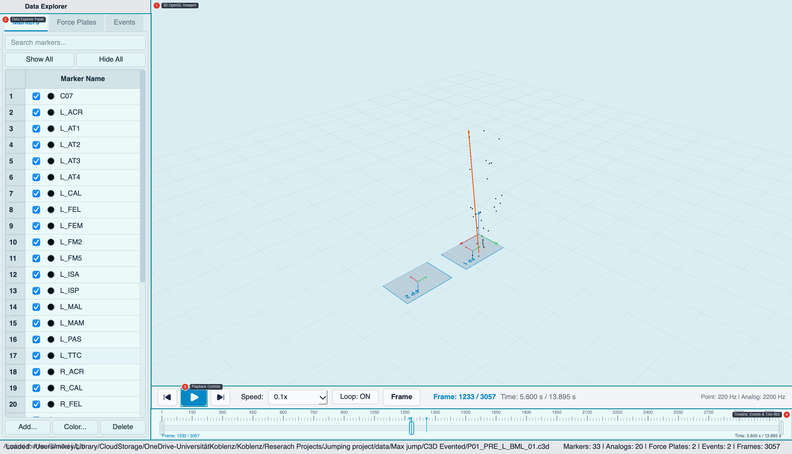
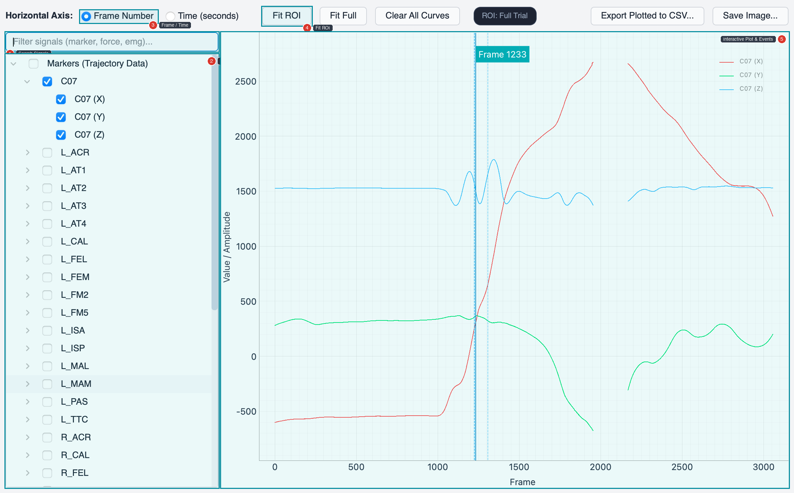
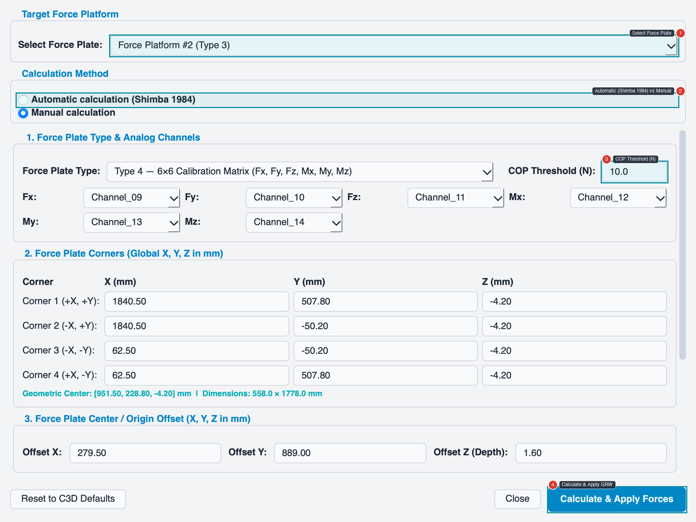
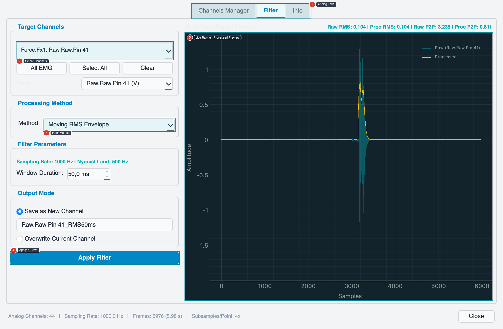
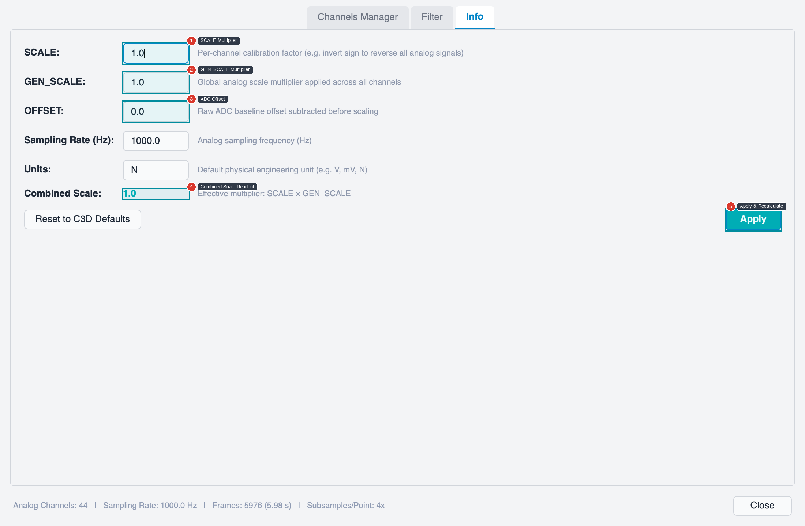
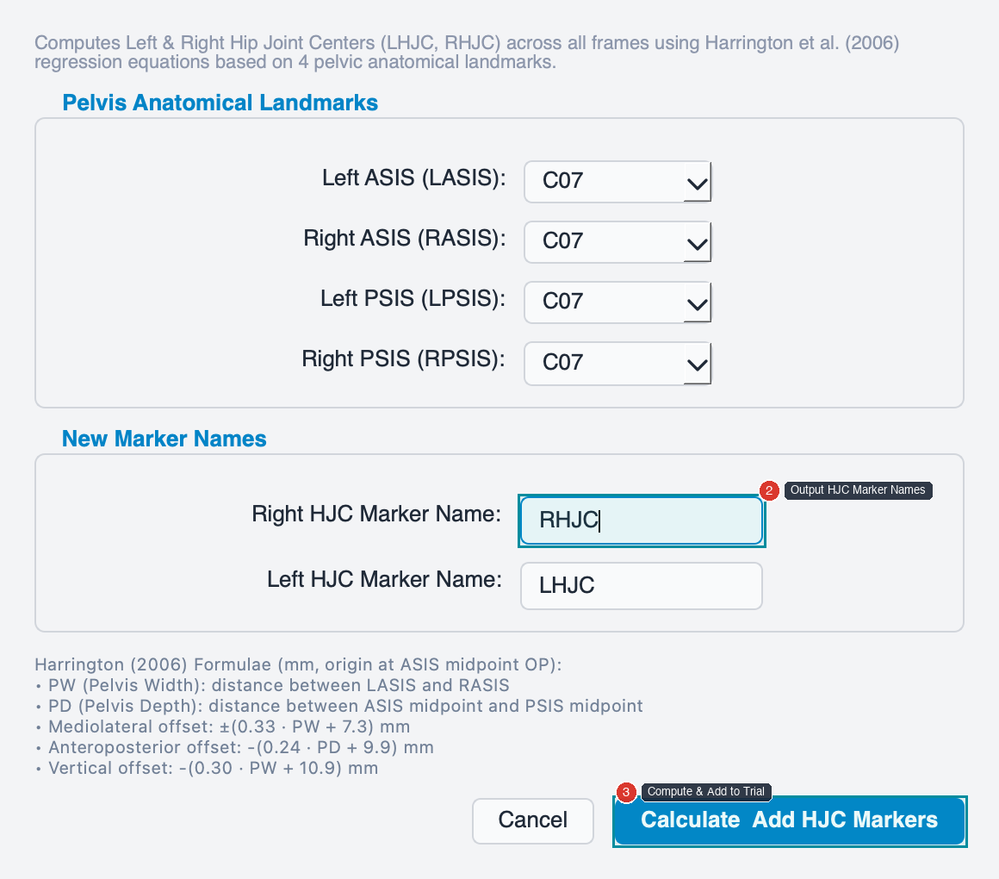
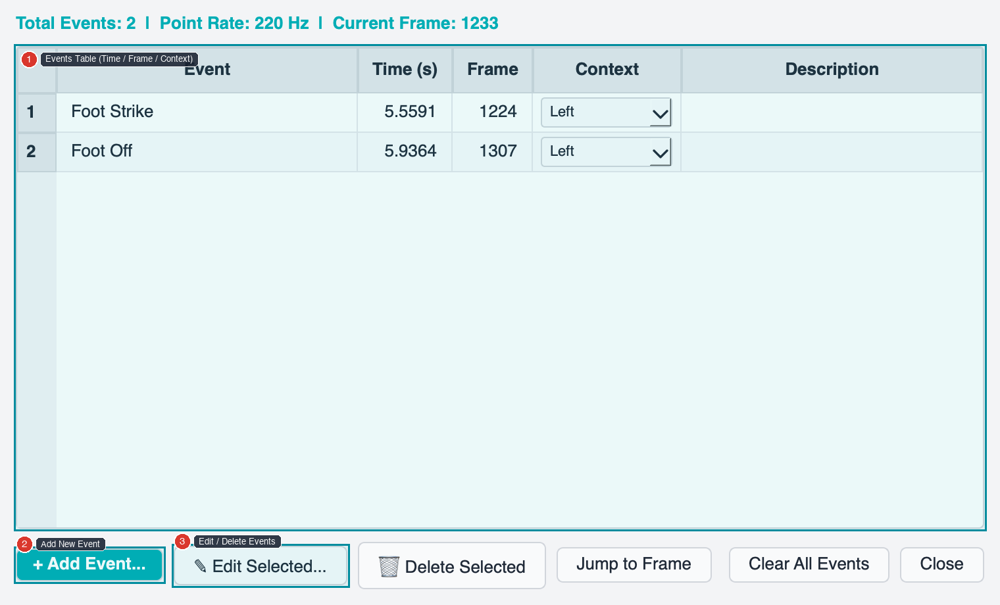
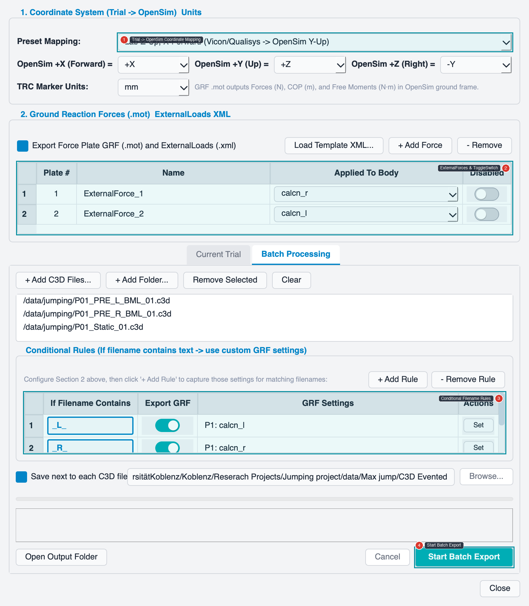
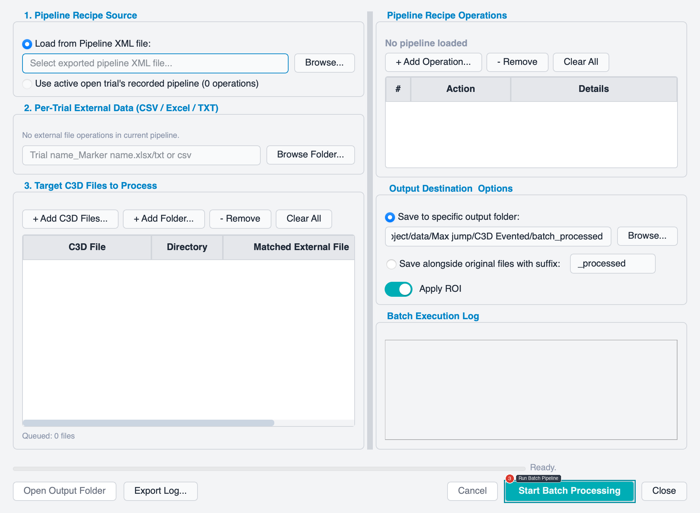
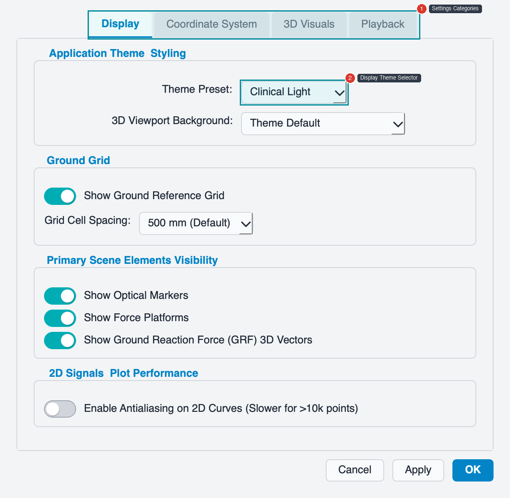

# C3D Explorer — Complete User Guide

Welcome to **C3D Explorer (v1.1)** — a cross-platform biomechanics desktop application for inspecting, editing, filtering, analyzing, and exporting C3D motion capture, analog/EMG, and force plate trials.

---

## Table of Contents

1. [Main Workspace & 3D Viewport](#1-main-workspace--3d-viewport)
2. [Universal Signal & Marker Plotter](#2-universal-signal--marker-plotter)
3. [Force Plate Ground Reaction Wrench (GRW)](#3-force-plate-ground-reaction-wrench-grw)
4. [Analog Channels & EMG Signal Processing](#4-analog-channels--emg-signal-processing)
5. [Analog Specifications (Info Tab)](#5-analog-specifications-info-tab)
6. [Marker Analysis & Kinematics Tools](#6-marker-analysis--kinematics-tools)
7. [Event Management & Timeline ROI](#7-event-management--timeline-roi)
8. [Export for OpenSim (.trc, .mot, .xml)](#8-export-for-opensim-trc-mot-xml)
9. [Batch Processing Pipelines](#9-batch-processing-pipelines)
10. [Visual Settings & Themes](#10-visual-settings--themes)
11. [Menus & Keyboard Shortcuts](#11-menus--keyboard-shortcuts)

---

## 1. Main Workspace & 3D Viewport

| Callout | Component | Description |
| :---: | :--- | :--- |
| **1** | **3D OpenGL Viewport** | Interactive 3D scene displaying optical markers, force platforms (`FP 1`, `FP 2`), and real-time Ground Reaction Force (GRF) vectors. Left-drag to orbit, scroll or right-drag to zoom, middle-drag to pan, and click markers to select. |
| **2** | **Data Explorer Panel** | Tabbed side panel with **Markers** (search, show/hide, multi-select, recolor, delete), **Force Plates** (live Fx/Fy/Fz & COP values), and **Events** (click to jump, edit, or delete). |
| **3** | **Playback Controls** | Play/pause (`Space`), step backward/forward (`←` / `→`), adjust speed (`0.1x`–`2.0x`), toggle **Loop**, and switch between **Frame** and **Time (s)**. |
| **4** | **Timeline, Events & Trim ROI** | Scrub across the trial, inspect color-coded events (Red = Right, Blue = Left, Amber = General), and drag **Trim Start `[`** and **Trim End `]`** handles to restrict playback and exports to an active Region of Interest (ROI). |

---

## 2. Universal Signal & Marker Plotter

Open via **`Tools → Plotter...`** (`Ctrl+P` / `Cmd+P`) or from **`View → Panels → Plotter`**.

| Callout | Control | Description |
| :---: | :--- | :--- |
| **1** | **Search Signals** | Filter the signal tree dynamically by marker, force plate, or analog channel name. |
| **2** | **Signal Tree** | Expand **Markers**, **Force Platforms**, or **Analog Channels** and check signals to plot immediately. Checking a parent marker plots all 3 components (`X`, `Y`, `Z`). |
| **3** | **Frame / Time Toggle** | Switch the horizontal axis between **Frame Number** and **Time (seconds)**. |
| **4** | **Fit ROI / Fit Full** | Automatically zoom the X and Y axes to either the trimmed ROI or the full trial. Analog channels automatically scale proportionally to their amplitude. |
| **5** | **Interactive Plot & Events** | Displays synchronized playback cursor, dashed vertical event lines, curve hover inspection, and axis-locked zooming (drag/scroll directly on the X or Y axis). |

---

## 3. Force Plate Ground Reaction Wrench (GRW)

Open via **`Tools → Force Plate...`** to configure or recalculate ground reaction forces, moments, and Center of Pressure (COP).

| Callout | Control | Description |
| :---: | :--- | :--- |
| **1** | **Select Force Plate** | Choose which force platform in the trial (`Force Platform #1`, `#2`, ...) to inspect or configure. |
| **2** | **Calculation Method** | Switch between **Automatic calculation (Shimba 1984)** and **Manual calculation** (full control over plate type, analog channel mapping, corners, origin offset, and 6×6 calibration matrix). Manual settings persist across sessions. |
| **3** | **COP Threshold (N)** | Minimum vertical force ($\|F_z\|$) required to compute COP. Below this threshold (swing/unloaded phase), COP is suppressed to prevent division-by-zero noise spikes. |
| **4** | **Calculate & Apply Forces** | Recomputes $F_x, F_y, F_z, M_x, M_y, M_z,$ and COP for the selected plate and updates the 3D viewport and plotter with full Undo/Redo support. |

---

## 4. Analog Channels & EMG Signal Processing

Open via **`Tools → Analog...`** to manage channels, import external CSV/TXT/XLSX signals, or run zero-phase Butterworth and EMG envelope filters.

| Callout | Control | Description |
| :---: | :--- | :--- |
| **1** | **Analog Tabs** | Switch between **Channels Manager** (rename, delete, import, plot), **Filter** (signal processing), and **Info** (C3D scaling specifications). |
| **2** | **Select Channels** | Multi-select dropdown plus one-click **All EMG**, **Select All**, and **Clear** buttons. |
| **3** | **Filter Method** | Choose **Butterworth Low-pass / High-pass / Band-pass / Notch**, **Full-Wave Rectification**, **Moving RMS Envelope**, or **EMG custom** (20–400 Hz BP + Rectification + 20 Hz LP). |
| **4** | **Apply Filter** | Save processed output as a new channel or overwrite existing channels with full **Undo / Redo** (`Ctrl+Z` / `Ctrl+Y`) support. |
| **5** | **Live Raw vs. Processed Preview** | Real-time overlay comparing the **Raw** waveform against the **Processed** signal alongside RMS and Peak-to-Peak (P2P) statistics. |

---

## 5. Analog Specifications (Info Tab)

Switch to the **Info** tab inside **`Tools → Analog...`** to inspect or modify global C3D analog parameters.

| Callout | Parameter | Description |
| :---: | :--- | :--- |
| **1** | **SCALE** | Per-channel calibration multiplier read from C3D metadata. Changing sign (e.g., `-1.0` → `+1.0`) reverses the polarity of all analog signals. |
| **2** | **GEN_SCALE** | Global analog scale multiplier applied across all channels. |
| **3** | **OFFSET** | Baseline ADC offset value. |
| **4** | **Combined Scale Readout** | Live product `SCALE × GEN_SCALE` showing the effective multiplier. |
| **5** | **Apply** | Applies updated parameters, rescales all analog channels, updates metadata, and recalculates connected force platforms (with **Reset to C3D Defaults** and Undo/Redo support). |

---

## 6. Marker Analysis & Kinematics Tools

Under **`Tools → Marker`** (or by right-clicking selected markers in the **3D Viewport** or **Data Explorer**):

* **Create Average Marker...** (2 markers): Computes midpoint trajectory across all frames.
* **Create Centroid Marker...** (3+ markers): Computes geometric centroid across multiple markers with NaN handling.
* **Hip Joint Center (Harrington)...** (4 pelvis markers): Computes `LHJC` and `RHJC` using Harrington et al. (2006) regression equations.
* **Measure Distance / Angle...**: Real-time 3D distance or joint angle with ROI statistics (`Mean`, `SD`, `Min`, `Max`) and 2D plotting.
* **Filter Markers...**: Zero-phase 4th-order Butterworth low-pass trajectory smoothing.

| Callout | Control | Description |
| :---: | :--- | :--- |
| **1** | **Pelvis Anatomical Landmarks** | Auto-matches `LASIS`, `RASIS`, `LPSIS`, and `RPSIS` from the trial (or select manually). |
| **2** | **Output HJC Marker Names** | Customize the generated Left and Right Hip Joint Center marker names (`LHJC`, `RHJC`). |
| **3** | **Calculate & Add HJC Markers** | Computes both trajectories across all frames and adds them to the 3D scene and marker table. |

---

## 7. Event Management & Timeline ROI

Open via **`Tools → Events...`** (`Ctrl+E` / `Cmd+E` to add at current frame, or right-click the timeline).

| Callout | Control | Description |
| :---: | :--- | :--- |
| **1** | **Events Table** | Lists all discrete events with **Event** name, **Time (s)**, **Frame**, **Context** (`Left`, `Right`, `General`), and **Description**. |
| **2** | **Add Event...** | Create a new event at the current frame or a custom timestamp/frame. |
| **3** | **Edit / Delete Events** | Modify event timing/context or remove events. All changes persist when saving/exporting C3D. |

---

## 8. Export for OpenSim (.trc, .mot, .xml)

Open via **`File → Export → Export for OpenSim (.trc, .mot, .xml)...`** to generate OpenSim-ready marker trajectories (`.trc`), Ground Reaction Forces (`.mot`), and `ExternalLoads` configuration (`.xml`).

| Callout | Control | Description |
| :---: | :--- | :--- |
| **1** | **Coordinate Mapping** | Convert from lab coordinates (e.g., *Lab Z-Up, X-Forward*) to OpenSim Y-Up (`+X` forward, `+Y` up, `+Z` right), or choose **Custom** axis mapping. Applies consistently to markers, forces, COP, and free moments. |
| **2** | **ExternalForces & ToggleSwitch** | Configure `Plate #`, `Name`, `Applied To Body` (e.g., `calcn_r`, `calcn_l`), and `Disabled` toggle switch. Optionally load an existing XML template via **Load Template XML...**. |
| **3** | **Conditional Filename Rules** | In **Batch Processing**, match filename substrings (e.g., `_L_`, `_R_`, `static`) to automatically apply different `ExternalLoads` or GRF enable/disable settings per trial. Click **Set** to save Section 2's table into a rule. |
| **4** | **Start Batch Export** | Runs multi-trial OpenSim export in a background thread, writing `<trial>.trc`, `<trial>_grf.mot`, and `<trial>_grf.xml`. |

---

## 9. Batch Processing Pipelines

Open via **`File → Batch Processing...`** or **`Tools → Batch Processing...`** (`Ctrl+Shift+B` / `Cmd+Shift+B`).

| Callout | Control | Description |
| :---: | :--- | :--- |
| **1** | **Pipeline Operations** | Build or load an XML pipeline recipe (`Export Pipeline (XML)...`) containing marker filters, EMG envelopes, average/HJC markers, and settings. |
| **2** | **C3D File Queue & External Pairing** | Drag and drop C3D files or folders, automatically pair external `.csv` / `.xlsx` / `.txt` data files by trial name, and inspect per-file status badges. |
| **3** | **Start Batch Processing** | Executes the full pipeline asynchronously across all queued trials with progress tracking and log export. |

---

## 10. Visual Settings & Themes

Open via **`Settings...`** (`Ctrl+,` / `Cmd+,`).

| Callout | Control | Description |
| :---: | :--- | :--- |
| **1** | **Settings Categories** | Switch between **Display**, **Coordinate System**, **3D Visuals**, and **Playback**. |
| **2** | **Display Theme Selector** | Choose from 6 built-in themes: **Biomech Dark**, **Clinical Light**, **Nordic Frost**, **Nordic Midnight**, **Graphite Slate**, and **Cyber Amber**. |

---

## 11. Menus & Keyboard Shortcuts

| Shortcut | Action |
| :--- | :--- |
| `Ctrl+O` / `Cmd+O` | Open C3D File |
| `Ctrl+S` / `Cmd+S` | Save C3D File |
| `Ctrl+Z` | Undo Last Operation |
| `Ctrl+Y` / `Cmd+Shift+Z` | Redo Last Operation |
| `Space` | Play / Pause Animation (within active Trim ROI) |
| `←` / `→` | Step Backward / Forward 1 Frame |
| `Ctrl+P` / `Cmd+P` | Open Universal Signal & Marker Plotter |
| `Ctrl+E` / `Cmd+E` | Add C3D Event at Current Frame |
| `Ctrl+Shift+B` / `Cmd+Shift+B` | Open Batch Processing |
| `Ctrl+,` / `Cmd+,` | Open Visual Settings |
| `Ctrl+Q` / `Cmd+Q` | Quit Application |
